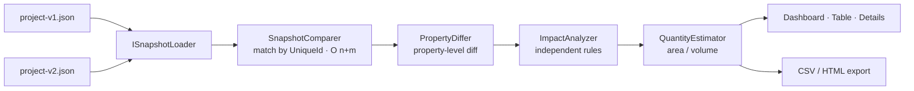
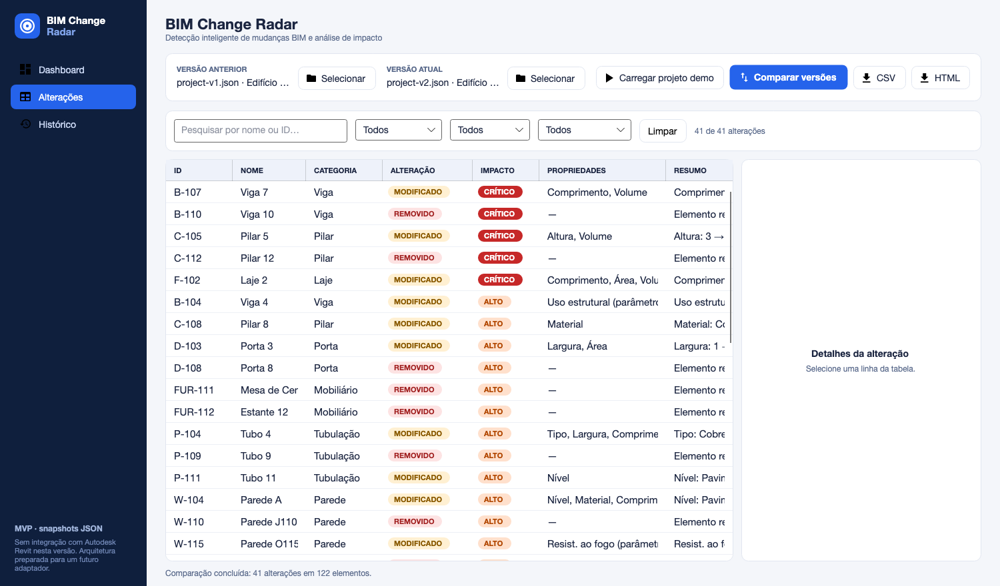

<div align="center">

# 📡 BIM Change Radar

**Intelligent BIM change detection & impact analysis**

[](https://dotnet.microsoft.com/)
[](https://avaloniaui.net/)
[](docs/TEST_REPORT.md)
[](#-run)
[](README.md)


</div>

A C#/.NET desktop app that compares two versions (snapshots) of a BIM model, detects **added, removed, modified and unchanged** elements, shows **exactly which properties changed**, estimates each change's **impact** with transparent rules, and exports reports (CSV and HTML).

> The UI is localized in Portuguese (pt-BR); this document describes it in English.

## Problem
BIM models change constantly. Finding out *what changed* between versions is usually manual, slow and error-prone — and not every change weighs the same: renaming a wall is not removing a column. BIM Change Radar answers: *What changed? What matters most? What needs review?*

## Features
- **Dashboard** with indicators computed from the loaded data (nothing hardcoded): totals, added/removed/modified/unchanged, high-impact count, distribution by impact and category
- **Real comparison keyed by stable `UniqueId`**, O(n+m), with numeric tolerance and text normalization to avoid false positives
- **Property-by-property diff**, including custom `Parameters` added/removed/changed
- **Impact Analyzer** (LOW / MEDIUM / HIGH / CRITICAL) built from independent, explainable rule classes, each decision with a stated reason
- **Quantity estimates** for area/volume (e.g. wall 8.96 m² → 13.44 m², +4.48 m²) — only when data exists, always labeled as *estimate*
- **Sortable, searchable, filterable table** (change type, impact, category) with a details panel (previous vs. current value, reason)
- **CSV export** (Excel-friendly) and **self-contained HTML report**
- **Persistent analysis history** (`history.json` in the user data folder) and a one-click **demo project**

## How it works

An element's impact is the **highest** impact among its changes. Structural categories: Column, Beam, Floor, Foundation.

## Impact rules
| Change | Impact | Reason |
|---|---|---|
| Name / Mark | LOW | Textual change, no geometry effect |
| Informational parameter | LOW | No geometric effect |
| Critical parameter (FireRating, LoadBearing…) | HIGH | Tied to performance/code requirements |
| Material | MEDIUM (HIGH if structural) | Specifications, quantities, cost |
| Type | MEDIUM | May change specification and quantities |
| Category / Level | HIGH | Coordination, sheets and quantities |
| Dimension | HIGH (CRITICAL if structural) | Quantities and related elements |
| Element added | MEDIUM | Review, documentation, quantities |
| Element removed | HIGH (CRITICAL if structural) | Documentation, quantities, coordination |

## Tech stack
C# · .NET 8 · **Avalonia UI** (XAML, cross-platform desktop) · MVVM with CommunityToolkit.Mvvm · System.Text.Json · LINQ · xUnit

> **Why Avalonia instead of WPF?** Development happened on macOS, where WPF doesn't run. Avalonia uses the same model (XAML + MVVM + data binding) on Windows/macOS/Linux, and porting the Views layer to WPF would be straightforward. Core and Infrastructure have no UI dependency.

## Architecture
```
BIMChangeRadar.sln
├── BIMChangeRadar.Core            # pure domain: no UI, no I/O
│   ├── Models/  Interfaces/  Comparison/  ImpactAnalysis/  Rules/  Services/
├── BIMChangeRadar.Infrastructure  # JSON, file system, CSV/HTML export
├── BIMChangeRadar.App             # Avalonia: Views, ViewModels (MVVM)
├── BIMChangeRadar.Tests           # xUnit (149 tests)
├── Samples/                       # project-v1.json, project-v2.json (+ generator)
├── tools/Screenshots              # headless UI rendering used to produce the screenshots
└── docs/                          # interview guide, test report, screenshots
```
Dependencies: `App → Infrastructure → Core`. A future Revit integration only needs a new `ISnapshotLoader` that produces the same `ModelSnapshot`; nothing in Core changes.

## 🚀 Run
Requires the [.NET 8 SDK](https://dotnet.microsoft.com/download).
```bash
git clone https://github.com/GiovanneMedeiros/BIMChangeRadar.git
cd BIMChangeRadar
dotnet run --project BIMChangeRadar.App      # launch the app
dotnet test                                   # run the tests
dotnet run --project tools/Screenshots        # (optional) regenerate screenshots
```

## Usage
1. Click **Carregar projeto demo** (Load Demo Project) to compare `Samples/project-v1.json` and `project-v2.json`, **or** pick your own two versions and click **Comparar versões** (Compare).
2. Review the indicators and impact distribution on the **Dashboard**.
3. In **Alterações** (Changes), search/filter/sort and click a row for details.
4. Export via **CSV** or **HTML**.

### Snapshot JSON format
```json
{ "projectName": "Alpha Building", "version": "2.0", "date": "2026-11-23T14:30:00",
  "elements": [ { "id": "W-104", "uniqueId": "wall-104", "name": "Wall A", "category": "Wall",
    "type": "Interior Wall", "level": "Floor 1", "material": "Concrete",
    "length": 3.2, "height": 2.8, "area": 8.96,
    "parameters": { "FireRating": "60min", "Comments": "Interior wall" } } ] }
```

## Sample result (demo data)
110 → 114 elements · **12 added · 8 removed · 21 modified · 81 unchanged** · 41 changes · 20 high-impact (5 CRITICAL).

Element **W-104**: `Length 3.2 → 4.8`, `Material Concrete → Drywall`, `Level Floor 1 → Floor 2` — estimated area increase of ~4.48 m²; associated quantities may need review.

| Changes table | Element details |
|---|---|
|  |  |

## Testing
**149 xUnit tests**, all passing: comparison scenarios, dashboard counters (independently recounted), every impact rule, area/volume estimates (including no-data cases), invalid/empty/duplicate/large JSON import, CSV (BOM, accents, injection) and HTML, persistent history, ViewModel filters/search/details, and performance with up to 50,000 elements. See [docs/TEST_REPORT.md](docs/TEST_REPORT.md).

## Current limitations
- **No Autodesk Revit integration** — JSON snapshots only; the architecture is ready but the integration is **not implemented**.
- Matching by `UniqueId`/`Id` only; a "recreated" element with a new ID is not detected.
- No real geometry analysis; quantities are estimates from JSON dimensions.
- Fixed heuristic impact rules (not configurable in the UI); metres assumed.
- History stores file paths (moved files won't reopen); export always covers the full analysis, ignoring table filters.
- Validated via headless rendering with simulated clicks and on macOS; not tested on Windows/Linux or with native file dialogs.

## Roadmap
Revit API integration · IFC support · Visual model comparison · AI-powered change explanations · Dependency analysis · BIM workflow automation · Advanced reporting (PDF) · Configurable rules

## Author
Built by **Giovanne** as a portfolio project at the intersection of software engineering and BIM.

Released under the [MIT License](LICENSE).
