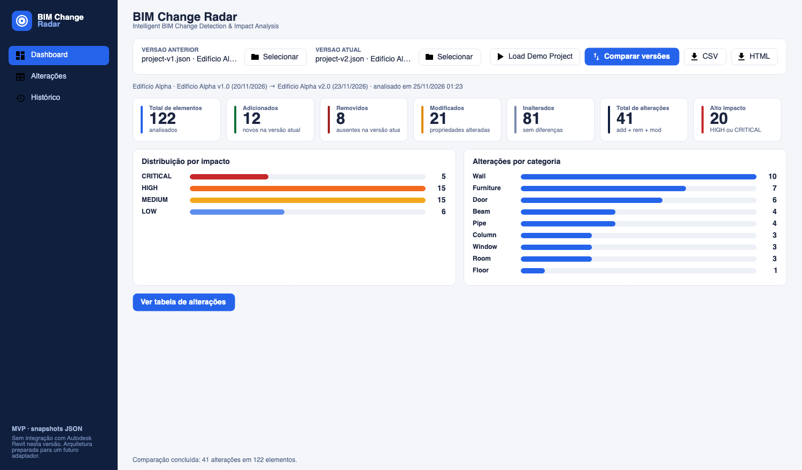

# BIM Change Radar
**Intelligent BIM Change Detection & Impact Analysis** · [Versão em português](README.md)

A desktop app (C#/.NET) that compares two versions (snapshots) of a BIM model, detects **added, removed, modified and unchanged** elements, shows **exactly which properties changed**, estimates each change's **impact** with transparent rules, and exports reports (CSV and HTML).



## Problem
BIM models change constantly. Finding out *what changed* between versions is usually manual, slow and error-prone, and not every change weighs the same: renaming a wall is not removing a column.

## Features
- Dashboard with indicators derived from the loaded data (nothing hardcoded)
- Real comparison keyed by stable `UniqueId`, with numeric tolerance and text normalization to avoid false positives
- Property-by-property diff, including custom `Parameters`
- Impact Analyzer (LOW / MEDIUM / HIGH / CRITICAL) built from independent, explainable rule classes
- Area/volume estimates, only when data exists and always labeled as estimates
- Sortable/filterable/searchable table with a details panel (previous vs. current value)
- CSV and self-contained HTML export, session history, one-click demo project

## Tech
C# · .NET 8 · Avalonia UI (XAML, cross-platform; WPF is Windows-only and development was done on macOS) · MVVM (CommunityToolkit.Mvvm) · System.Text.Json · LINQ · xUnit

## Architecture
`App → Infrastructure → Core`. Core holds models, the comparison engine, impact rules and quantity estimation, with no UI or I/O. A future Revit adapter only needs to produce a `ModelSnapshot`.

## Run
```bash
dotnet run --project BIMChangeRadar.App
dotnet test
```
Click **Load Demo Project**, or pick two JSON files and **Comparar versões** (Compare).

## Limitations
No Autodesk Revit integration yet (JSON snapshots only); matching by ID only; no real geometry analysis; heuristic fixed rules; metres assumed; in-memory history.

## Roadmap
Revit API integration · IFC support · Visual model comparison · AI-powered change explanations · Dependency analysis · BIM workflow automation · Advanced reporting
