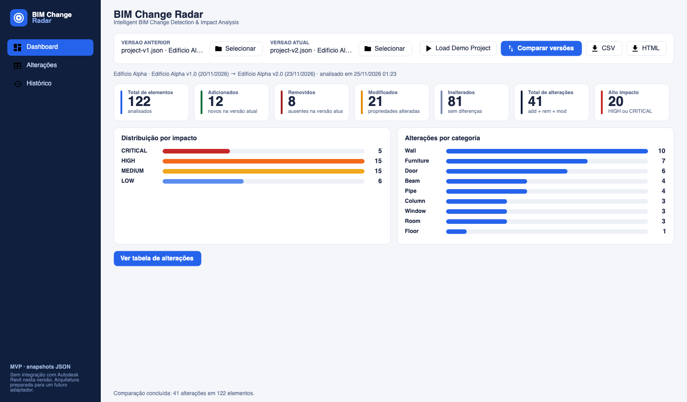
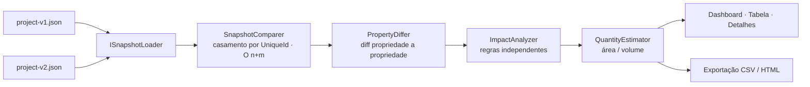
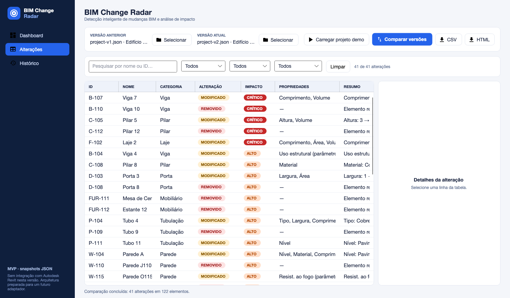
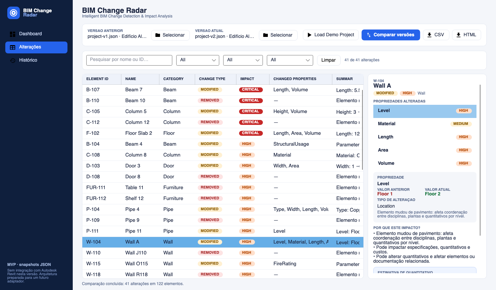
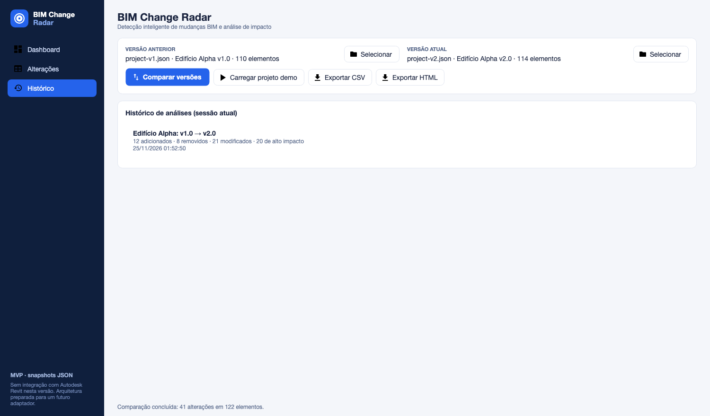

<div align="center">

# 📡 BIM Change Radar

**Detecção inteligente de mudanças e análise de impacto em modelos BIM**

[](https://dotnet.microsoft.com/)
[](https://avaloniaui.net/)
[](docs/TEST_REPORT.md)
[](#-como-executar)
[](README.en.md)



</div>

Aplicação desktop em C#/.NET que compara duas versões (snapshots) de um modelo BIM, identifica o que foi **adicionado, removido, modificado ou não mudou**, mostra **exatamente quais propriedades mudaram**, estima o **impacto** de cada alteração com regras explicáveis e gera relatórios (CSV e HTML).

## 📑 Sumário
- [Problema](#problema) · [Objetivo](#objetivo) · [Funcionalidades](#funcionalidades)
- [Como funciona](#como-funciona) · [Regras de impacto](#regras-de-impacto)
- [Tecnologias](#tecnologias) · [Arquitetura](#arquitetura)
- [Como executar](#-como-executar) · [Como usar](#como-usar) · [Formato do snapshot](#formato-do-snapshot-json)
- [Exemplo de resultado](#exemplo-de-resultado-dados-de-demonstração) · [Testes](#testes)
- [Limitações](#limitações-atuais) · [Roadmap](#roadmap-future-development) · [Autor](#autor)

## Problema
Em projetos BIM, versões do modelo mudam o tempo todo. Descobrir *o que mudou* entre duas versões costuma ser manual (abrir os dois modelos, comparar tabelas, conferir parâmetros), lento e sujeito a erro. Pior: nem toda mudança pesa igual — renomear uma parede é diferente de remover um pilar.

## Objetivo
Reduzir a comparação manual e priorizar a revisão: responder rapidamente *O que mudou? O que tem maior impacto? O que precisa de revisão?*

## Funcionalidades
- **Dashboard** com indicadores calculados a partir dos dados carregados (total, adicionados, removidos, modificados, inalterados, total de alterações, alto impacto), distribuição por impacto e por categoria.
- **Comparação real por `UniqueId`** (chave estável) em O(n+m), com tolerância numérica e normalização de texto para evitar falsos positivos.
- **Diferença propriedade a propriedade**, incluindo parâmetros personalizados (`Parameters`) adicionados/removidos/alterados.
- **Impact Analyzer** (LOW / MEDIUM / HIGH / CRITICAL) com regras independentes e motivo explicado para cada decisão.
- **Estimativa quantitativa** de área/volume (ex.: parede 8,96 m² → 13,44 m², +4,48 m²) — só quando há dados; sempre rotulada como *estimativa*.
- **Tabela** ordenável, com busca por nome/ID, filtros por tipo de alteração, impacto e categoria; painel de detalhes (valor anterior × atual, tipo, motivo).
- **Exportação CSV** (Excel pt-BR) e **relatório HTML** autocontido.
- **Histórico** de análises **persistido em disco** (`history.json` na pasta de dados do usuário; ao reabrir, o app recompara os arquivos originais) e botão **Carregar projeto demo**.

## Como funciona

1. Cada versão é lida como um `ModelSnapshot` (lista de `BimElement`).
2. Os elementos são casados por `UniqueId` (fallback `Id`): ausentes na V1 = *adicionados*, ausentes na V2 = *removidos*.
3. Nos elementos presentes nas duas versões, o `PropertyDiffer` compara cada propriedade e cada parâmetro personalizado, com tolerância numérica e texto normalizado (sem falsos positivos).
4. Cada alteração passa pelas regras de impacto; o elemento herda o **maior** impacto entre suas alterações.

## Regras de impacto
| Alteração | Impacto | Motivo |
|---|---|---|
| Nome / Mark | LOW | Alteração textual sem mudança geométrica |
| Parâmetro informativo | LOW | Sem efeito geométrico |
| Parâmetro crítico (FireRating, LoadBearing…) | HIGH | Ligado a requisitos de desempenho/normas |
| Material | MEDIUM (HIGH se estrutural) | Especificações, quantitativos, custo |
| Tipo | MEDIUM | Pode mudar especificação e quantitativos |
| Categoria / Nível | HIGH | Coordenação, plantas e quantitativos |
| Dimensão | HIGH (CRITICAL se estrutural) | Quantitativos e elementos relacionados |
| Elemento adicionado | MEDIUM | Revisão, documentação, quantitativos |
| Elemento removido | HIGH (CRITICAL se estrutural) | Documentação, quantitativos, coordenação |

O impacto do elemento é o **maior** impacto entre suas alterações. Estruturais: Column, Beam, Floor, Foundation.

## Tecnologias
C# · .NET 8 · **Avalonia UI** (XAML, desktop multiplataforma) · MVVM com CommunityToolkit.Mvvm · System.Text.Json · LINQ · xUnit · Git

> **Por que Avalonia e não WPF?** O projeto foi desenvolvido em macOS, onde WPF não executa (WPF é exclusivo do Windows). Avalonia usa o mesmo modelo (XAML + MVVM + data binding), roda em Windows/macOS/Linux, e a migração para WPF seria direta na camada de Views. Core e Infrastructure não dependem de UI.

## Arquitetura
```
BIMChangeRadar.sln
├── BIMChangeRadar.Core            # domínio puro, sem UI nem I/O
│   ├── Models/                    # BimElement, ModelSnapshot, ElementChange, PropertyChange...
│   ├── Interfaces/                # ISnapshotLoader, ISnapshotComparer, IImpactAnalyzer, IReportExporter, regras
│   ├── Comparison/                # SnapshotComparer, PropertyDiffer
│   ├── ImpactAnalysis/            # ImpactAnalyzer (orquestra regras)
│   ├── Rules/                     # uma classe por regra de impacto
│   └── Services/                  # QuantityEstimator
├── BIMChangeRadar.Infrastructure  # JSON, FileSystem, Export (CSV/HTML)
├── BIMChangeRadar.App             # Avalonia: Views, ViewModels (MVVM), Resources
├── BIMChangeRadar.Tests           # xUnit (149 testes)
├── Samples/                       # project-v1.json, project-v2.json (+ gerador)
├── tools/Screenshots              # renderiza a UI em headless para gerar as imagens do README
└── docs/                          # INTERVIEW_GUIDE.md e screenshots
```
Dependências: `App → Infrastructure → Core`. Para integrar o Revit no futuro basta um novo `ISnapshotLoader`/exportador que gere o mesmo `ModelSnapshot`; nada no Core muda.

## 🚀 Como executar
Requisitos: [.NET 8 SDK](https://dotnet.microsoft.com/download) (Windows, macOS ou Linux).
```bash
git clone https://github.com/GITHUB_USER/BIMChangeRadar.git
cd BIMChangeRadar
dotnet run --project BIMChangeRadar.App      # abrir o app
dotnet test                                   # rodar os testes
dotnet run --project tools/Screenshots        # (opcional) regenerar screenshots
```

## Como usar
1. Clique em **Carregar projeto demo** (carrega `Samples/project-v1.json` e `project-v2.json` e compara), **ou** use **Selecionar** para escolher suas duas versões e **Comparar versões**.
2. No **Dashboard**, veja os indicadores e a distribuição de impacto.
3. Em **Alterações**, pesquise/filtre/ordene e clique numa linha para ver os detalhes.
4. Exporte com **CSV** ou **HTML**.

### Formato do snapshot JSON
```json
{ "projectName": "Edifício Alpha", "version": "2.0", "date": "2026-11-23T14:30:00",
  "elements": [ { "id": "W-104", "uniqueId": "wall-104", "name": "Wall A", "category": "Wall",
    "type": "Interior Wall", "level": "Floor 1", "material": "Concrete",
    "length": 3.2, "height": 2.8, "area": 8.96,
    "parameters": { "FireRating": "60min", "Comments": "Interior wall" } } ] }
```

## Exemplo de resultado (dados de demonstração)
110 → 114 elementos · **12 adicionados · 8 removidos · 21 modificados · 81 inalterados** · 41 alterações · 20 de alto impacto (5 CRITICAL).

Elemento **W-104**: `Length 3.2 → 4.8`, `Material Concrete → Drywall`, `Level Floor 1 → Floor 2` · *"A alteração aumentou aproximadamente 4,48 m² da área estimada deste elemento. Os quantitativos associados podem precisar de revisão."*

| Tabela de alterações | Detalhe do elemento |
|---|---|
|  |  |



## Testes
**149 testes xUnit**, todos aprovados: cenários de comparação, contadores do dashboard (recontados de forma independente), cada regra de impacto, estimativas de área/volume (incluindo casos sem dados), importação de JSON inválido/vazio/duplicado/grande, CSV (BOM, acentos, injection) e HTML, histórico persistente, filtros/busca/detalhes via ViewModel e desempenho com até 50.000 elementos. Além disso, `dotnet run --project tools/Screenshots` executa a janela real em modo headless, clica nas abas e botões, mede tempos com 10.000 elementos e gera as imagens. Detalhes em [docs/TEST_REPORT.md](docs/TEST_REPORT.md).

## Limitações atuais
- **Sem integração com Autodesk Revit** — usa snapshots JSON. A arquitetura está preparada, mas a integração **não está implementada**.
- Casamento só por `UniqueId`/`Id`; não detecta elemento "recriado" com novo ID.
- Geometria real não é analisada; quantitativos são estimativas baseadas em dimensões do JSON.
- Regras de impacto são heurísticas fixas (não configuráveis pela UI).
- Unidades assumidas em metros; o histórico guarda os caminhos dos arquivos (se forem movidos, a análise antiga não reabre); a exportação sempre inclui a análise completa (ignora os filtros da tabela).
- Interface validada em renderização headless (com cliques simulados) e execução no macOS; não testada em Windows/Linux nem com os diálogos nativos de arquivo. Janelas muito pequenas (1100×680) ficam compactas.

## Roadmap (Future Development)
Revit API integration · IFC support · Visual model comparison · AI-powered change explanations · Dependency analysis · BIM workflow automation · Advanced reporting (PDF) · regras configuráveis.

## Autor
Desenvolvido por **Giovanne** como projeto de portfólio na interseção entre engenharia de software e BIM.
Sugestões e *issues* são bem-vindas.
